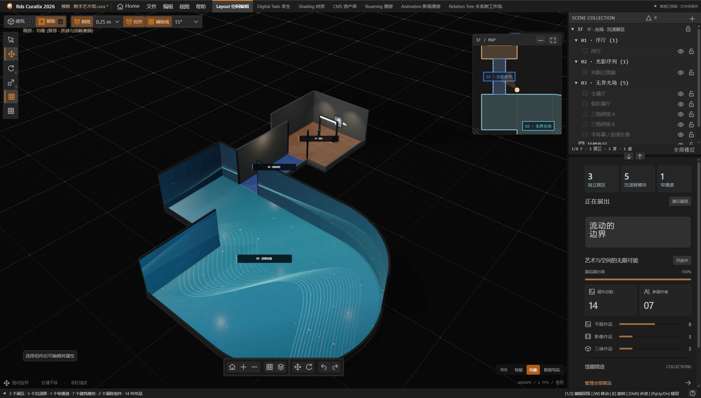

  

<h1 align="center">Rds Curatix</h1>

A modular 3D gallery, exhibition design, and digital twin studio.

  <a href="https://greentailtohru-arch.github.io/Rds-Curatix/">Launch Web App</a>
  &nbsp;·&nbsp;
  <a href="https://github.com/GreentailTohru-arch/Rds-Curatix/releases/latest">Download for Windows</a>
  &nbsp;·&nbsp;
  <a href="https://github.com/GreentailTohru-arch/Rds-Curatix/issues">Report an Issue</a>

## Overview

Rds Curatix is a visual workspace for building virtual exhibitions, arranging artwork, and exploring galleries through interactive and cinematic tours. The Windows desktop app and the web app share the same exhibition tools and portable project format.

**Rds Curatix is proprietary, closed-source software.** This is the official distribution repository. Application source code, development projects, and user exhibition files are not published here.

## Features

- **Modular exhibition spaces** — assemble multi-floor galleries with geometric rooms, corridors, stairs, and named exhibition zones.
- **Exhibition tools** — place wall-mounted frames, display walls, glass showcases, sculpture plinths, screens, lighting, and furniture.
- **Immersive media** — bind separate elevation and floor video channels across connected immersive screens, with aspect-ratio and resolution guidance.
- **Physical rendering** — explore procedural materials, museum lighting, soft shadows, and adjustable rendering quality.
- **Interactive and cinematic tours** — navigate galleries directly, visualize tour routes, and edit camera movements and artwork focus.
- **VR roaming** — choose joystick, teleport, or hybrid locomotion before entering VR or from the spatial menu. Uses a compatible renderer when the headset does not grant WebGPU XR.
- **SteamVR launch on Windows** — launch a local EGOlite / Chrome / Edge VR preview from the desktop app with the current exhibition and unsaved changes; connect the headset using Steam Link or Virtual Desktop.
- **Connected workflows** — manage artwork in the asset library and inspect spatial and content relationships in the relation tree.
- **Portable projects** — save `.cura` projects or exchange `.json` files with embedded exhibition assets between desktop and web.

## Download

The current desktop release is **2026.3.6** for **Windows x64**.

| Package | Description |
| --- | --- |
| [Windows Installer](https://github.com/GreentailTohru-arch/Rds-Curatix/releases/download/v2026.3.6/Rds-Curatix-2026-2026.3.6-x64-Setup.exe) | Installs the desktop app, creates shortcuts, and registers the `.cura` project file association. |
| [Windows Portable](https://github.com/GreentailTohru-arch/Rds-Curatix/releases/download/v2026.3.6/Rds-Curatix-2026-2026.3.6-x64-Portable.exe) | Runs the desktop app without an installer. |
| [SHA-256 Checksums](https://github.com/GreentailTohru-arch/Rds-Curatix/releases/download/v2026.3.6/SHA256SUMS-2026.3.6.txt) | Verifies the integrity of the official downloads. |

Release notes and other available versions are listed on the [Releases page](https://github.com/GreentailTohru-arch/Rds-Curatix/releases).

## Web App

Open **[Rds Curatix for the Web](https://greentailtohru-arch.github.io/Rds-Curatix/)**. A desktop browser with WebGPU support and compatible graphics hardware provides the best experience. Rendering performance depends on the graphics hardware, selected quality, and exhibition complexity.

The web app stores local drafts in the current browser. Export a project to keep a portable backup or move it to another browser or to the desktop app.

### VR Controls

In the web app, open **View → WebXR Roaming**, choose **摇杆 (Joystick)**, **位移 (Teleport)**, or **混合 (Hybrid)**, and start VR. Use the left stick to walk, hold/release the trigger to aim/teleport, and flick the right stick for a 45° snap turn. The grip button brings the spatial menu in front of you; point and press the trigger to change modes or exit.

Use a WebXR-capable headset browser over HTTPS. This update was verified with emulated XR sessions and stereo rendering; physical headset validation remains necessary.

### SteamVR from the Windows App

Open **View → WebXR Roaming → SteamVR 串流** and click **启动 SteamVR**. Connect the headset to the PC through Steam Link or Virtual Desktop and wait for SteamVR to show it as ready. Then click **打开展厅预览**, and click **开始 VR** in the new preview window. Accept the browser's immersive-VR permission prompt if shown.

This compatibility path uses a separate browser window for stereoscopic WebXR. The exhibition snapshot includes unsaved edits; subsequent changes can be sent with **重新连接 / 更新展厅**. Chrome / Edge previews start a fresh browser process on reconnect. EGOlite uses its existing browser configuration. Imported media stays on the PC and is streamed locally to the browser. Keep the desktop app open; **结束预览** disconnects the preview without altering the original project.

The launcher detects SteamVR, browsers and the current OpenXR runtime. EGOlite is selected first when installed and retains its working VR configuration. Chrome / Edge request SteamVR for their preview process without changing the system default. If no headset is detected, select SteamVR as the current runtime in **SteamVR Settings → OpenXR**, close the preview window, and launch it again. Actual headset and wireless-network validation is still required; the app does not supply its own headset streaming transport.

Controller input supports analog trigger and grip values when a browser does not emit select/squeeze events, with no duplicate action when both are available. Spatial menus show a hit cursor and hover highlight. Opening the VR dashboard, losing tracking or disconnecting a controller cancels pending teleportation. The status panel distinguishes connected controllers from missing joystick axes.

## Workspace UI in 2026.3.6

The title row shows the app and project name, with window controls on Windows. A second row contains Home, menus and workspace tabs. Opening another menu, clicking outside, choosing an action or pressing Escape closes the previous menu. Home contains recent projects; quick-start cards live exclusively in the official venue library. About shows the software version from the same package metadata as the desktop installer.

The desktop VR dialog offers SteamVR streaming only. VR setup, movement cards, connection feedback, the session monitor and the floating headset menu share the dark workspace theme and orange accents. Joystick, teleport and hybrid modes remain available.

## Getting Started

1. Install the Windows app, run the portable edition, or open the web app.
2. Open a recent project from Home, create a gallery, or choose a quick-start template in the official venue library.
3. Assemble spaces and place exhibition modules in the workspace.
4. Import artwork and media in the asset library, then bind them to exhibits or immersive channels.
5. Explore the exhibition or configure a cinematic tour.
6. Save or export your project as `.cura` or `.json`.

On desktop, `Ctrl+S` saves and `Ctrl+Shift+S` saves a new copy. In the web app, saving downloads a portable project. `Ctrl+O` opens a compatible project. Press `M` in the gallery workspace to open the floor map.

## Workspace Preview

## Repository Contents

- `assets/` — product logo and application preview.
- `web/` — pre-built web application distributed through GitHub Pages.
- `.github/workflows/` — deployment of the pre-built web application.

This repository does not include the development environment, application source project, or editable exhibition project files. GitHub's automatically generated repository archives contain only these public distribution materials.

## Feedback

Please [open an issue](https://github.com/GreentailTohru-arch/Rds-Curatix/issues/new) for a reproducible problem or a feature request. Include the app version, operating system, graphics hardware, and reproduction steps. Attach only materials you intend to make public.

## License

Copyright © 2026 Rds. All rights reserved.

Rds Curatix is proprietary software and is not released under an open-source license. Publication of desktop binaries and the compiled web client does not make the application's development source available.

### Quest controllers visible but joystick input missing

On Windows, an installed Ultraleap OpenXR layer can interfere with physical Quest controller input. If Curatix reports missing joystick axes, check Ultraleap Control Panel → Settings → **OpenXR Support**. Turning it off and restarting the VR browser restored joystick walking, snap turning and buttons in our Quest 3 / Steam Link / EGOlite hardware test. This setting also affects Ultraleap hand tracking in other OpenXR applications and can be re-enabled in the same panel. No Ultraleap uninstall or system runtime change is required. A web page cannot change the computer’s OpenXR plugin settings.
