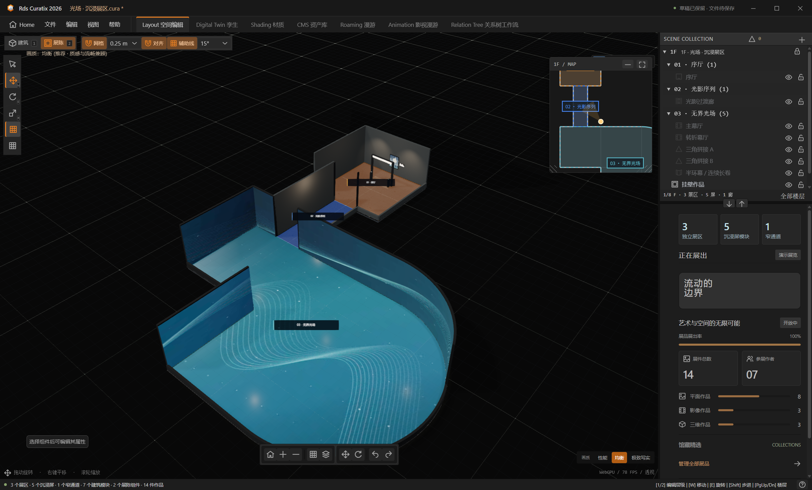
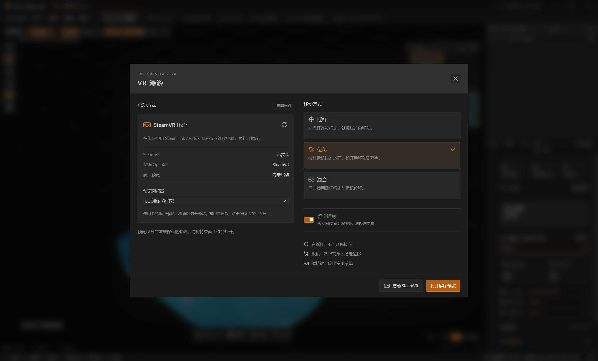

<strong>EN</strong> | <a href="./README.zh-CN.md">CN</a>

  
  <h1>Rds Curatix</h1>
  
<em>Design an exhibition, stage its media, and walk through it in 3D.</em>

  

    
    
    
    
  

  

    
  

  
  
The built-in Light Field exhibition in the Windows workspace.

## What is Rds Curatix?

Rds Curatix is a modular 3D gallery, exhibition design, and digital twin studio. Build a venue from rooms, passages, stairs, and exhibition zones. Arrange works and media in the same project, then review the result on foot, through an authored camera route, or in a compatible VR headset.

The Windows and web editions share the exhibition tools and project format. Start in the browser or use the desktop app to open and save projects directly on disk.

## Download

| Edition | Get it | Use it for |
| --- | --- | --- |
| **Web app** | [Launch in browser](https://greentailtohru-arch.github.io/Rds-Curatix/) | Open a gallery or start from a template without installing the desktop app. |
| **Windows x64 installer** | [Download Setup.exe](https://github.com/GreentailTohru-arch/Rds-Curatix/releases/download/v2026.3.7/Rds-Curatix-2026-2026.3.7-x64-Setup.exe) | Install with shortcuts and register the `.cura` file association. |
| **Windows x64 portable** | [Download Portable.exe](https://github.com/GreentailTohru-arch/Rds-Curatix/releases/download/v2026.3.7/Rds-Curatix-2026-2026.3.7-x64-Portable.exe) | Run the desktop app without an installer. |

Windows packages above are **2026.3.7**. [SHA-256 checksums](https://github.com/GreentailTohru-arch/Rds-Curatix/releases/download/v2026.3.7/SHA256SUMS-2026.3.7.txt) · [All releases](https://github.com/GreentailTohru-arch/Rds-Curatix/releases)

For the web edition, a desktop browser with WebGPU and compatible graphics hardware is recommended. Rendering performance depends on the scene, hardware, and quality preset.

## Quick start

1. Open **Home** for recent projects, or start a new project. Open the **Official Venue Library** (`官方场馆模板库`) to start from a built-in venue.
2. In **Layout**, place and size architectural modules, organize floors and zones, then add exhibit fixtures.
3. In **CMS**, import artwork, video, or 3D assets and bind them to the exhibits or immersive surfaces that should display them.
4. Review the floor map, walk the gallery in **Roaming**, or author a camera route in **Animation**.
5. Save a `.cura` project or export `.json` with its referenced assets for use on another device.

## Workspaces

| Workspace | What you can do |
| --- | --- |
| **Layout** | Assemble geometric rooms, curved surfaces, passages, and stairs. Organize them into floors and zones. Resize rooms with outline feedback during the drag. |
| **Digital Twin** | Review the venue, floor map, zone layout, and exhibition contents. |
| **Shading** | Adjust materials and lighting. Switch rendering presets to balance visual detail and responsiveness. |
| **CMS** | Organize artwork and media and assign them to frames, display walls, showcases, plinths, and screens. Bind separate elevation and floor video channels to connected immersive surfaces. |
| **Roaming** | Walk the exhibition or open the VR preview controls. |
| **Animation** | Plan camera routes and edit shots, movement, and artwork focus. |
| **Relation Tree** | Inspect links between spaces, exhibit fixtures, and content. |

## Project files

Both `.cura` and `.json` use the same portable project format. A saved project can contain the venue geometry, exhibits, media bindings, relationship graph, camera routes, and embedded assets referenced by the project.

- **Windows** saves `.cura` directly to disk. Use **Save As** to create a separate copy and **Export JSON** for interchange.
- **Web** keeps drafts in the current browser. Save or export a project file to back up the exhibition or move it between devices or editions.

| Shortcut | Action |
| --- | --- |
| `Ctrl+O` | Open a `.cura` or `.json` project. |
| `Ctrl+S` | Save on desktop or download the project on web. |
| `Ctrl+Shift+S` | Save a separate project copy. |
| `M` | Open the floor map in the gallery workspace. |

## VR preview

### WebXR in a headset browser

Open the web app in a compatible headset browser over HTTPS. In the gallery, choose **View → WebXR Roaming** (`视图 → WebXR 漫游`), choose a movement mode, and select **Start VR**. Curatix can use a compatible renderer when the session does not provide WebGPU XR.

### SteamVR on Windows

1. Open **View → WebXR Roaming** and select **Start SteamVR** (`启动 SteamVR`).
2. Connect the headset through **Steam Link** or **Virtual Desktop** and wait for SteamVR to show it as ready.
3. Select **Open Exhibition Preview** (`打开展厅预览`). The desktop launcher uses EGOlite when available and also offers installed Chrome or Edge browsers.
4. In the preview window, select **Start VR** (`开始 VR`) and accept the browser's VR permission prompt if it appears.

The preview includes unsaved exhibition edits and reads referenced media through a temporary local connection. Keep Curatix open during the session. Use **Reconnect / Update Exhibition** to refresh the preview after editing, or **End Preview** to disconnect it.

View the Windows SteamVR setup panel

  

| Input | Action |
| --- | --- |
| Left stick | Walk in **Joystick** or **Hybrid** mode. |
| Trigger | Aim and release to teleport in **Teleport** or **Hybrid** mode. Point and press to select a spatial menu item. |
| Right stick | Snap turn by 45°. |
| Grip | Bring the spatial menu into view to change modes, reset position, or exit. |

Troubleshoot headset and controller detection

- **Headset not detected:** check the connection in SteamVR before opening the preview. If the headset connected after the preview opened, choose **Reconnect / Update Exhibition** and try again.
- **Quest controllers detected but sticks do not respond:** on Windows, check for an Ultraleap OpenXR conflict. On a Quest 3 with Steam Link and EGOlite, turning off **OpenXR Support** in the Ultraleap Control Panel and restarting the preview browser restored the joystick inputs. The same setting controls Ultraleap hand tracking in other OpenXR apps.

## Feedback

For a bug report, include the Curatix version, edition, OS, GPU, rendering preset, and steps to reproduce. For VR issues, also include the headset, connection method, browser, and the session status shown in Curatix. [Open an issue](https://github.com/GreentailTohru-arch/Rds-Curatix/issues/new)

## Distribution

Rds Curatix is proprietary software. This is its official distribution repository. It contains product documentation, branding, and the compiled web app. Windows binaries are distributed through GitHub Releases. The automatic repository archives contain these public distribution files. [Proprietary software notice](NOTICE.md)
