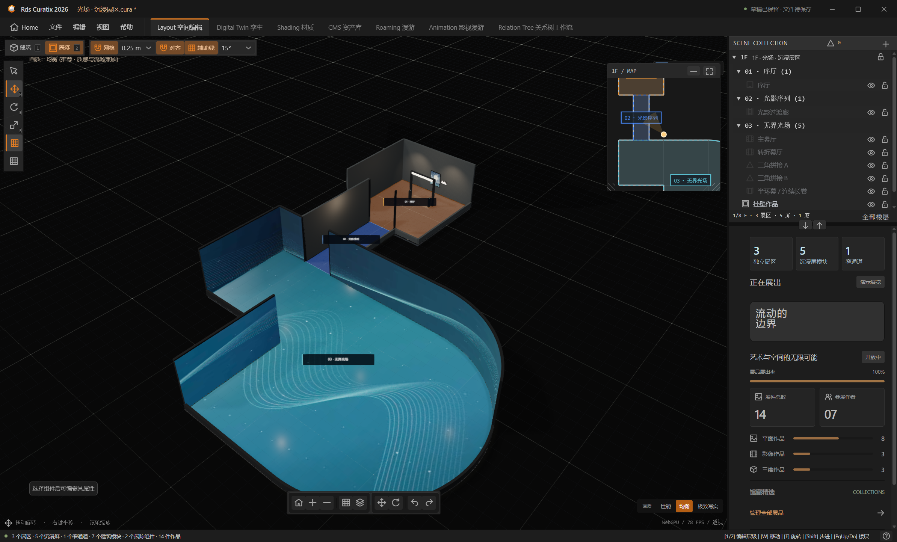
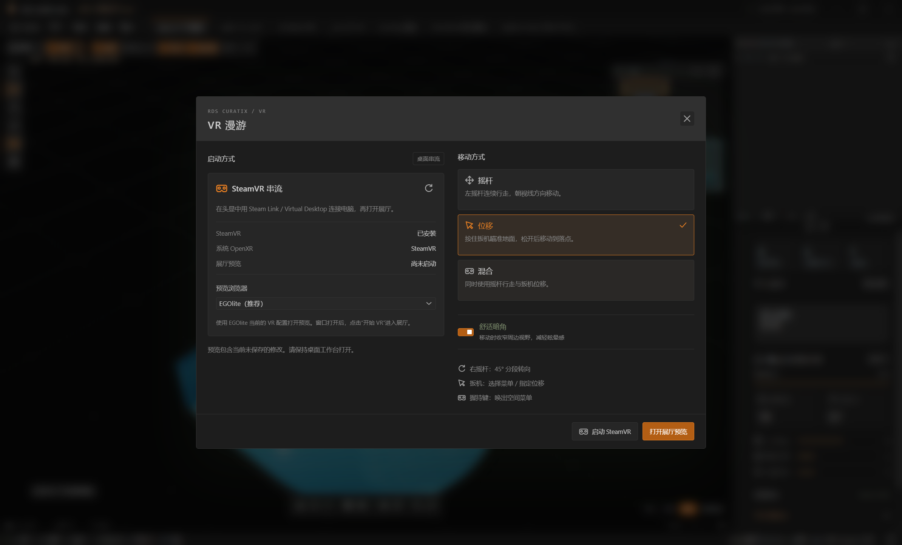

<a href="./README.md">EN</a> | <strong>CN</strong>

  
  <h1>Rds Curatix</h1>
  
<em>搭建数字展厅，编排展品与影像，走进你设计的展览。</em>

  

    
    
    
    
  

  

    
  

  
  
Windows 桌面版实拍 · 内置「光场 · 沉浸展区」

## 产品介绍

Rds Curatix 是一款用于数字展馆搭建、展陈设计和数字孪生预览的三维工作台。你可以用展厅、通道、楼梯等模块搭建场馆，按楼层和展区组织空间，再放置展品、配置灯光和沉浸影像。布展完成后，可以步行漫游、按编排的镜头路线播放，或戴上兼容的 VR 头显看展。

Windows 桌面版与网页版共用展陈工具和工程格式。可以在浏览器里开始策展，也可以用桌面版直接打开和保存磁盘上的工程。

## 下载

| 版本 | 获取方式 | 适用场景 |
| --- | --- | --- |
| **网页版** | [在浏览器中打开](https://greentailtohru-arch.github.io/Rds-Curatix/) | 直接打开已有工程，或从内置场馆模板开始。 |
| **Windows x64 安装版** | [下载 Setup.exe](https://github.com/GreentailTohru-arch/Rds-Curatix/releases/download/v2026.3.7/Rds-Curatix-2026-2026.3.7-x64-Setup.exe) | 安装桌面应用、创建快捷方式并关联 `.cura` 工程文件。 |
| **Windows x64 便携版** | [下载 Portable.exe](https://github.com/GreentailTohru-arch/Rds-Curatix/releases/download/v2026.3.7/Rds-Curatix-2026-2026.3.7-x64-Portable.exe) | 下载后可直接运行。 |

上表中的 Windows 安装包为 **2026.3.7**。[SHA-256 校验文件](https://github.com/GreentailTohru-arch/Rds-Curatix/releases/download/v2026.3.7/SHA256SUMS-2026.3.7.txt) · [所有发行版本](https://github.com/GreentailTohru-arch/Rds-Curatix/releases)

网页版建议使用支持 WebGPU 的桌面浏览器与兼容的显卡。场景规模、硬件和画质档位都会影响预览流畅度。

## 快速开始

1. 点击 **Home** 打开最近项目或新建工程。想从示例开始，可以进入 **官方场馆模板库** 选择场馆。
2. 在 **空间编辑** 中放置并调整建筑模块，设置楼层和展区，再添加展墙、画框、展柜等展陈组件。
3. 在 **资产库** 中导入作品、视频或三维资产，将素材绑定到展陈组件或沉浸屏。
4. 用楼层地图检查布局，进入 **漫游** 看展，或在 **影视漫游** 中编排镜头和路线。
5. 保存为 `.cura`，或导出包含引用素材的 `.json`，以便备份或换设备继续编辑。

## 工作区

| 工作区 | 主要操作 |
| --- | --- |
| **空间编辑** | 搭建几何展厅、曲面、通道和楼梯，组织楼层与展区。拖动尺寸时显示轮廓预览。 |
| **孪生** | 查看场馆整体布局、楼层地图、展区及展出内容。 |
| **材质** | 调整场景材质和灯光，根据预览需求选择画质档位。 |
| **资产库** | 管理作品与媒体，将其分配到画框、展墙、展柜、展台和屏幕。为相连的沉浸屏分别设置立面与地面视频。 |
| **漫游** | 在展厅内步行参观，或通过「视图」菜单打开 VR 设置。 |
| **影视漫游** | 编排镜头路线，调整镜头运动和对焦作品。 |
| **关系树工作流** | 查看空间、展陈组件与内容之间的关系。 |

## 工程文件

`.cura` 和 `.json` 采用同一工程格式，可保存建筑几何、展品、媒体绑定、关系树、漫游路线及工程引用的内嵌素材。

- **Windows 桌面版** 可直接将 `.cura` 写入磁盘。使用「另存为」创建副本，或选择「导出通用 JSON（含素材）」进行交换。
- **网页版** 将草稿保存在当前浏览器中。通过保存或导出下载工程文件，以便备份或在另一台设备上打开。

| 快捷键 | 操作 |
| --- | --- |
| `Ctrl+O` | 打开 `.cura` 或 `.json` 工程。 |
| `Ctrl+S` | 桌面版保存到磁盘，网页版下载工程。 |
| `Ctrl+Shift+S` | 将工程另存为副本。 |
| `M` | 在展厅工作区中打开楼层地图。 |

## VR 漫游

### 通过头显浏览器进入 WebXR

在兼容的头显浏览器中通过 HTTPS 打开网页版。进入展厅后，选择 **视图 → WebXR 漫游**，选择移动方式，再点击 **开始 VR**。如果当前会话不支持 WebGPU XR，Curatix 可切换到兼容渲染模式。

### 在 Windows 上通过 SteamVR 串流

1. 选择 **视图 → WebXR 漫游**，点击 **启动 SteamVR**。
2. 在头显中通过 **Steam Link** 或 **Virtual Desktop** 连接电脑，等待 SteamVR 显示头显已就绪。
3. 点击 **打开展厅预览**。如果已安装 EGOlite，桌面版会优先选用它，也可以选择已安装的 Chrome 或 Edge。
4. 在预览窗口点击 **开始 VR**。如果浏览器弹出权限提示，允许进入沉浸模式。

预览包含当前未保存的修改，并通过临时本地连接读取工程素材。预览期间请保持 Curatix 开启。修改展厅后可用 **重新连接 / 更新展厅** 刷新预览，或点击 **结束预览** 断开连接。

查看 Windows SteamVR 设置界面

  

| 手柄输入 | 操作 |
| --- | --- |
| 左摇杆 | 在 **摇杆** 或 **混合** 模式下行走。 |
| 扳机 | 在 **位移** 或 **混合** 模式下瞄准落点，松开扳机完成位移。指向空间菜单时，按下扳机即可选中。 |
| 右摇杆 | 每次分段转向 45°。 |
| 握持键 | 唤出空间菜单，可切换移动模式、重置站位或退出 VR。 |

排查头显和手柄连接

- **未检测到头显**。在打开展厅预览前，先确认 SteamVR 已识别头显。如果是在打开预览后才连接头显，点击 **重新连接 / 更新展厅** 再试。
- **Quest 手柄已连接，但摇杆无响应**。在 Windows 上检查是否有 Ultraleap OpenXR 输入冲突。在 Quest 3、Steam Link 和 EGOlite 的实测中，关闭 Ultraleap 控制面板的 **OpenXR Support** 并重启预览浏览器后，摇杆恢复工作。此开关也影响其他 OpenXR 应用使用 Ultraleap 手势追踪。

## 问题反馈

报告问题时，请附上 Curatix 版本、使用的客户端、操作系统、显卡、画质档位和复现步骤。若涉及 VR，请补充头显型号、连接方式、浏览器，以及 Curatix 显示的会话状态。[提交 Issue](https://github.com/GreentailTohru-arch/Rds-Curatix/issues/new)

## 软件发行

Rds Curatix 是专有软件。本仓库用于发布产品文档、品牌素材和编译后的网页版。Windows 安装包与便携版通过 GitHub Releases 发布。GitHub 自动生成的仓库压缩包包含这里公开的发行文件。[专有软件声明](NOTICE.md)
